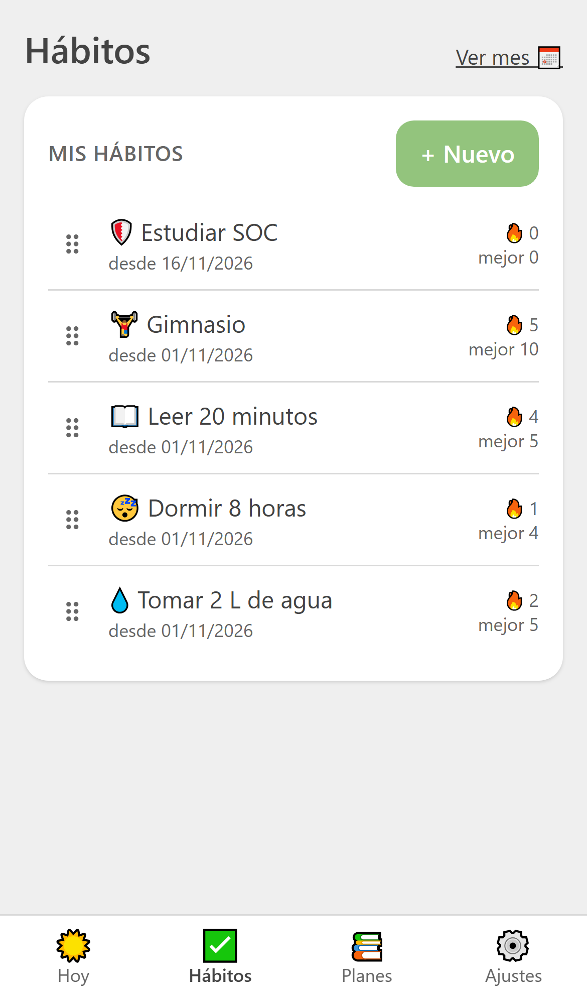
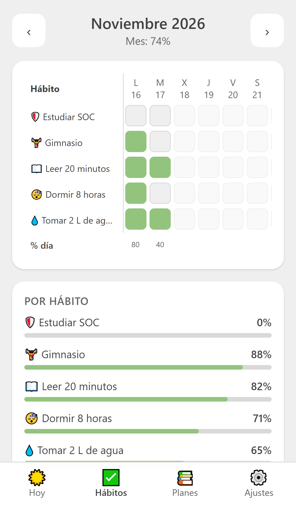
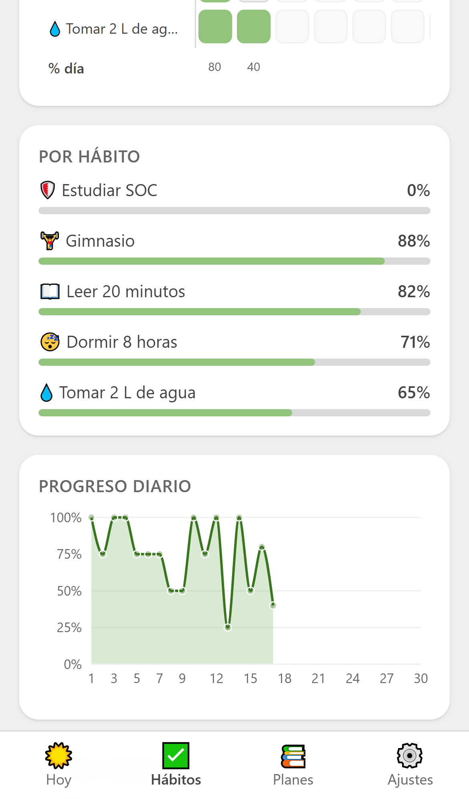
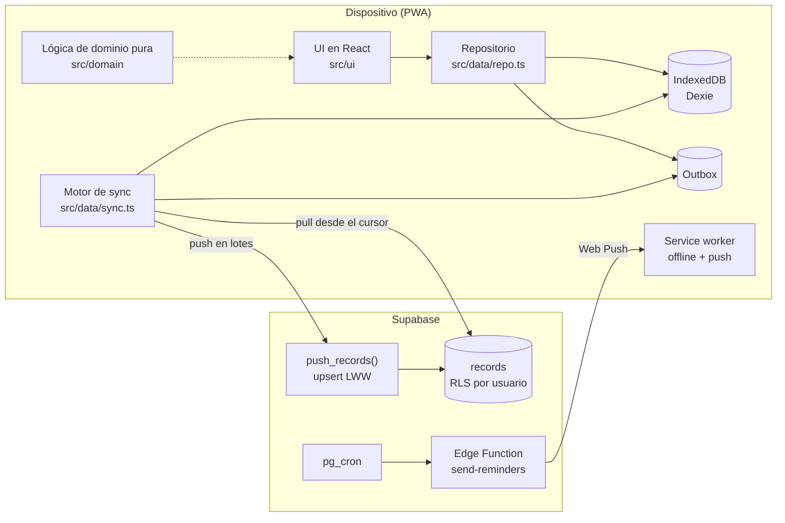

# Hábitos

**Seguimiento de hábitos y planificador de estudio local-first, para el teléfono y la computadora.** Es una PWA instalable que funciona completamente offline, sincroniza entre dispositivos con Supabase y manda una notificación push a la mañana al iPhone.

> **Demo:** [habitos-app-vtve.vercel.app](https://habitos-app-vtve.vercel.app) (sin cuenta funciona en modo local) · 🇬🇧 [Read in English](README.md)

<p align="center">
  
  
  
  
</p>

## Por qué la hice

Llevaba mis hábitos y planes de estudio en planillas. En la compu andaban bien, pero en el teléfono eran incómodas. Además no respondían la pregunta que más me importaba: *"si hoy hago 3 lecciones, ¿cuándo termino?"*. Esta app reemplaza esas planillas por algo que abro todas las mañanas.

## Funcionalidades

- **Resumen del día.** Las tareas de hoy, los hábitos, los planes activos y cómo estás de ánimo y motivación, todo en una pantalla.
- **Tareas por dictado.** Decís *"dentista a las 15 horas, comprar yerba, después llamar a Juan"* con el micrófono del teclado del iPhone y quedan tres tareas, una a las 15:00. El separador funciona por reglas: corta por puntuación y conectores ("después", "luego", "también") y entiende horas como *"9 y media"*, *"3 de la tarde"*, *"18.30 hs"* o *"al mediodía"*.
- **Hábitos con vigencia.** Un hábito cuenta solo entre su fecha de inicio y su fecha de fin, así que agregar o dar de baja uno no cambia los porcentajes de días pasados. Tiene racha actual y mejor racha, grilla mensual y gráficos de tendencia.
- **Planes de estudio.** Importás una lista de ítems (uno por línea, con `Módulo: ítem` opcional) y definís el ritmo, los días de descanso, las fechas bloqueadas y las etapas. Un plan se puede vincular a un hábito, que se marca solo el día que completás un ítem.
- **PWA offline-first.** Un service worker de Workbox guarda la app entera en caché. Todo se escribe primero en IndexedDB, así que la app nunca espera a la red.
- **Sincronización entre dispositivos.** Login con mail y contraseña en Supabase; si hay conflicto, gana el último cambio.
- **Recordatorio push a la mañana.** Web Push a la PWA instalada en iOS. Lo programa `pg_cron` y lo manda una Edge Function de Supabase, en la zona horaria de cada usuario.
- **Respaldo.** Exportás e importás todos tus datos en JSON.

## Arquitectura



### Decisiones interesantes

- **Local-first con outbox.** La UI nunca habla con la red. Cada escritura marca `updatedAt` y suma el registro a un outbox, en la misma transacción de Dexie. El motor de sync vacía el outbox en lotes: después de cada cambio (con debounce), al abrir la app, cuando vuelve la conexión, cuando la app vuelve al frente y una vez por minuto mientras está visible.
- **Una sola tabla genérica en el servidor.** Cada colección local se guarda como filas de `records(user_id, collection, id, data jsonb, updated_at, deleted_at, server_ts)`. Sumar una colección nueva no necesita migración.
- **"Gana el último cambio", aplicado en SQL.** `push_records()` hace un solo `INSERT … ON CONFLICT DO UPDATE … WHERE excluded.updated_at > r.updated_at`, así que el servidor rechaza las escrituras viejas. Los timestamps del cliente son estrictamente crecientes, por lo que dos escrituras en el mismo milisegundo nunca empatan.
- **Reloj del servidor para el cursor de pull.** Los relojes de los dispositivos se desfasan, así que el pull usa un `server_ts` del servidor (`clock_timestamp()`) con un pequeño margen de solapamiento, en lugar del `updatedAt` del cliente.
- **Borrados lógicos.** Las marcas `deletedAt` hacen que los borrados lleguen a todos los dispositivos.
- **Row Level Security.** Una sola política, `user_id = auth.uid()`, separa los datos de cada usuario. El cliente solo tiene la publishable key.
- **Fechas como strings locales `YYYY-MM-DD`.** Los días nunca se guardan como timestamps UTC. Así se evita el clásico bug del "hábito marcado en el día equivocado después de las 21 h" en UTC−3.
- **Capa de dominio pura y testeada.** Los porcentajes, las rachas, el separador de dictado, el parseo de ítems y la lógica del recordatorio son TypeScript puro, sin React ni I/O, y están cubiertos con Vitest.

## Motor de reprogramación (en curso)

El corazón del planificador es `src/domain/schedule.ts`. Cuenta los días disponibles según los días de descanso y las fechas bloqueadas, arma un cronograma base, proyecta uno nuevo desde hoy según el avance real y calcula métricas como cuántos días voy adelantado o atrasado y la fecha estimada de fin.

Este módulo lo estoy implementando **yo, a mano y guiado por tests**, como ejercicio de pensamiento algorítmico. La especificación ya está escrita como **57 tests de Vitest** (`src/domain/schedule.test.ts`), y en [`docs/GUIA_REPROGRAMACION.md`](docs/GUIA_REPROGRAMACION.md) hay una guía con los casos borde. Mientras una función no está hecha, la UI captura el `NotImplementedError` y muestra un aviso de "pendiente" en lugar de romperse.

## Tecnologías

| Capa | Herramientas |
|---|---|
| Frontend | React 19, TypeScript, Vite, Tailwind CSS 4, React Router |
| Datos locales | IndexedDB con Dexie (`dexie-react-hooks` para consultas en vivo) |
| Backend | Supabase: Postgres, Auth, RLS, Edge Functions (Deno), `pg_cron` |
| PWA | `vite-plugin-pwa` (injectManifest), Workbox, Web Push (VAPID) |
| Gráficos y UI | Recharts, dnd-kit (reordenar arrastrando) |
| Tests | Vitest + `fake-indexeddb` (dominio, store, sync), Playwright (end-to-end en un iPhone emulado) |
| Hosting | Vercel |

## Estructura

```
src/domain     lógica pura: fechas, hábitos, tareas (dictado), planes, schedule
src/data       esquema de Dexie, store con outbox, motor de sync, repositorio, respaldo, push
src/ui         pantallas y componentes
src/charts     gráficos (Recharts)
src/sw.ts      service worker: caché offline + notificaciones push
supabase/      migraciones SQL, Edge Function send-reminders, configuración del cron
e2e/           prueba end-to-end con Playwright
```

## Correrla en local

```bash
npm install
npm run dev          # http://localhost:5173 (anda sin claves, en modo solo local)
npm test             # Vitest
npm run e2e          # Playwright (iPhone 13 emulado)
npm run build        # build de producción con service worker
```

Para activar la sincronización y el push, copiá `.env.example` a `.env.local` y completá la URL de Supabase, la publishable key y la clave pública VAPID. La guía completa explica la configuración de Supabase, las migraciones, la Edge Function, el cron, el deploy en Vercel y cómo instalarla en el iPhone: [`docs/SETUP.md`](docs/SETUP.md).

> **En Windows:** usá `npm test` y no `npx vitest`. Un script intermedio corrige un problema con la mayúscula de la unidad (`c:`) que hace que Vitest cargue los tests dos veces.

## Cómo la hice

La hice con un asistente de IA para programar en pareja (Claude Code), con un acuerdo de trabajo explícito que está en [`CLAUDE.md`](CLAUDE.md). La IA se encargó del armado del proyecto, la UI y las capas de datos y sincronización. El motor de reprogramación lo escribo yo, y ahí la IA solo da pistas y revisa el código.

## Próximos pasos

- Terminar el motor de reprogramación y sumar un gráfico burn-up por plan (plan base, real y proyección)
- Panel anual (`yearStats` ya está hecho y testeado)
- Exportar a CSV
- Sincronización en tiempo real con Supabase Realtime en lugar de consultar cada minuto

Más ideas en [`IDEAS.md`](IDEAS.md).

## Licencia

[MIT](LICENSE)
