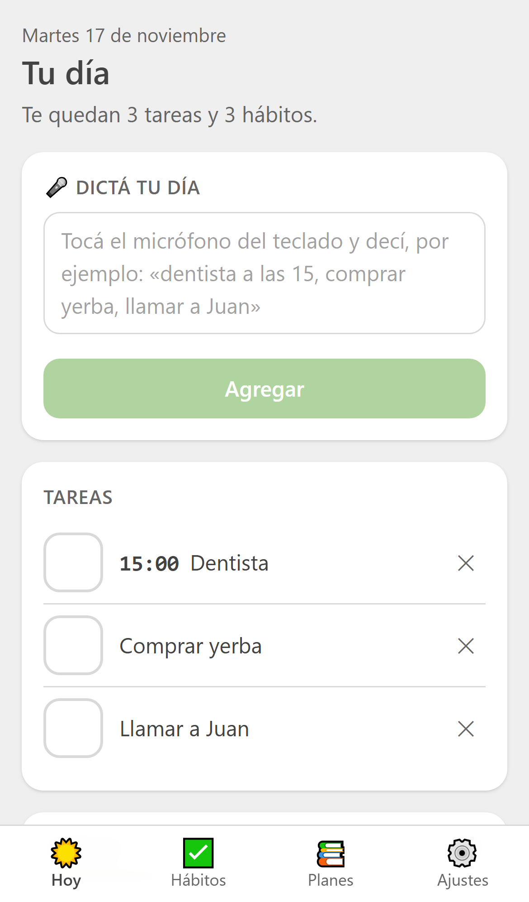
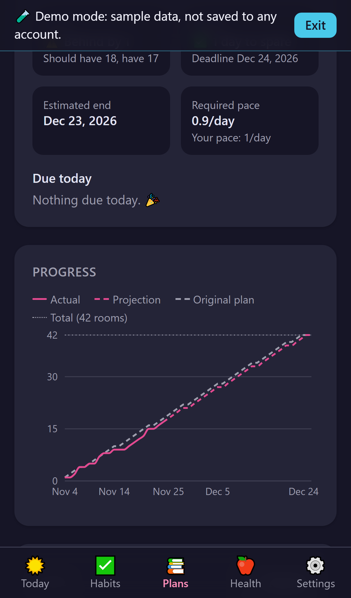
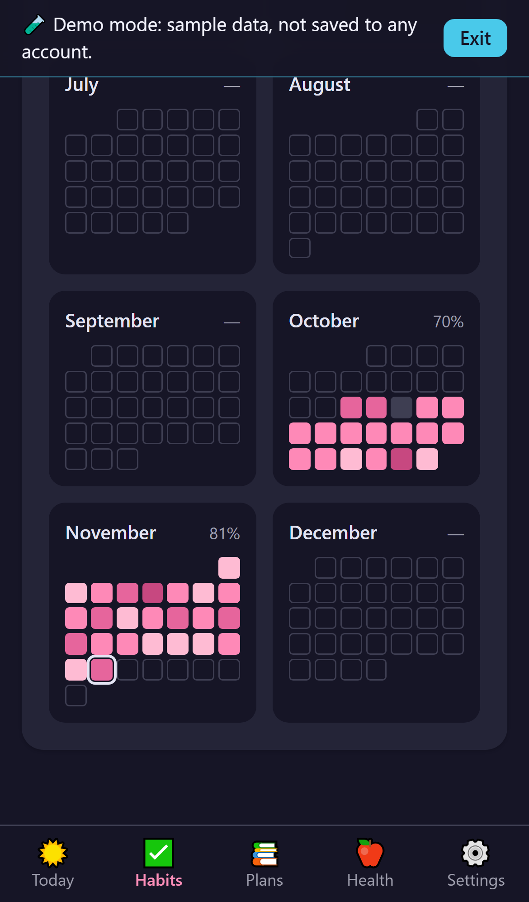
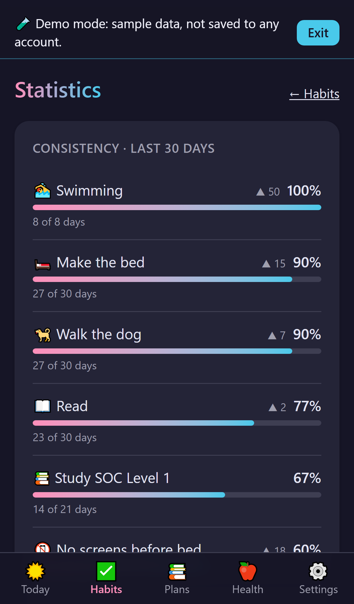
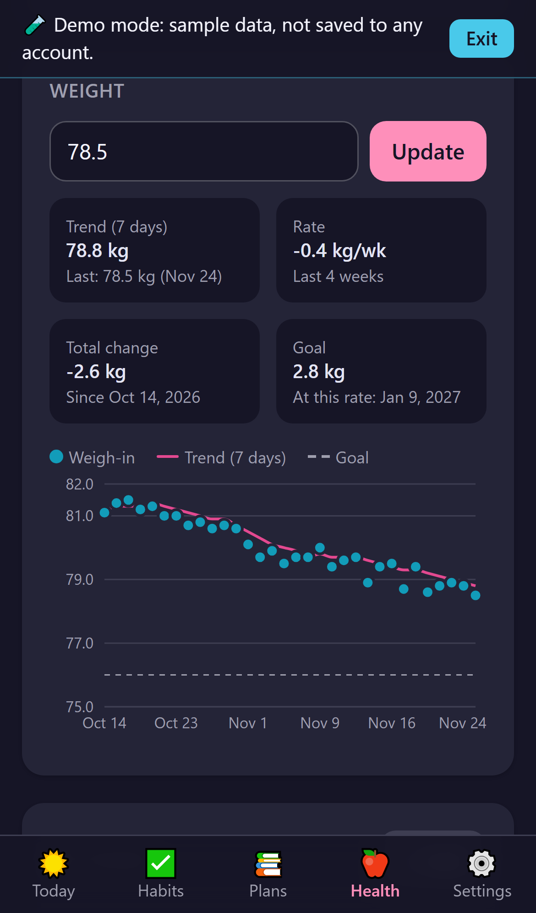
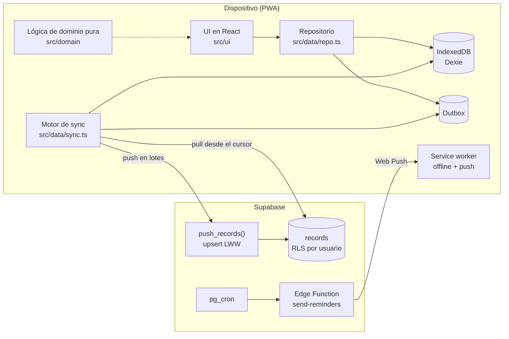

# Hábitos

[](https://github.com/Tata-14Dev/habitos-app/actions/workflows/ci.yml)

**Seguimiento de hábitos y planificador de estudio local-first, para el teléfono y la computadora.** Es una PWA instalable que funciona completamente offline, sincroniza entre dispositivos con Supabase y manda una notificación push a la mañana al iPhone.

> **Demo:** [abrila con datos de ejemplo](https://habitos-app-vtve.vercel.app/?demo=1): seis semanas de hábitos, un curso a mitad de camino, gráficos y salud, en una base local aparte (sin cuenta) · 🇬🇧 [Read in English](README.md)

<p align="center">
  
</p>

<p align="center">
  
  
  
  
  
  
</p>

| Lighthouse (móvil, producción) | Rendimiento | Accesibilidad | Buenas prácticas | SEO |
|---|---|---|---|---|
| [habitos-app-vtve.vercel.app](https://habitos-app-vtve.vercel.app/?demo=1) | 92 | 100 | 100 | 100 |

## Por qué la hice

Llevaba mis hábitos y planes de estudio en planillas. En la compu andaban bien, pero en el teléfono eran incómodas. Además no respondían la pregunta que más me importaba: *"si hoy hago 3 lecciones, ¿cuándo termino?"*. Esta app reemplaza esas planillas por algo que abro todas las mañanas.

## Funcionalidades

- **Resumen del día.** Las tareas de hoy, los hábitos, los planes activos y cómo estás de ánimo y motivación, todo en una pantalla.
- **Tareas por dictado.** Decís *"dentista a las 15 horas, comprar yerba, después llamar a Juan"* con el micrófono del teclado del iPhone y quedan tres tareas, una a las 15:00. El separador funciona por reglas: corta por puntuación y conectores ("después", "luego", "también") y entiende horas como *"9 y media"*, *"3 de la tarde"*, *"18.30 hs"* o *"al mediodía"*.
- **Tres tipos de hábito.** *Fijos*: todos los días (hacer la cama, pasear al perro), con un momento del día opcional (mañana, tarde o noche). *Del día*: algunos días de la semana o una sola fecha. *Con progreso*: una cantidad por día o por semana (1 h por día, 5 h por semana) o una cantidad de veces por semana (gimnasio 3 veces). "Hoy" muestra solo lo que toca, agrupado por momento del día, más las metas de la semana.
- **Porcentajes y rachas justos.** Un hábito cuenta solo los días que le tocan y dentro de su vigencia, así que agregar, dar de baja o cambiar los días de un hábito no altera los porcentajes pasados. Las rachas diarias saltean los días que no tocan y las metas semanales llevan la racha en semanas. Hay grilla mensual y gráficos de tendencia.
- **Planes de estudio que se reprograman solos.** Hay dos tipos: **por ítems** (una lista de rooms, lecciones o capítulos, que pegás uno por línea con `Módulo: ítem` opcional) y **por cantidad** (un total de horas, páginas o ejercicios, que registrás día a día). Alcanza con decir cuántos son ("34 rooms") y el ritmo por día: la fecha de fin se calcula sola, salteando los días de descanso y los libres (o ponés tu propia fecha límite). ¿Ya ibas por la mitad? Decís "62 en total, ya hice hasta el 31": del 1 al 31 cuentan como hechos antes del plan, el cronograma arranca en el 32 y la app muestra "Vas por: Room 32". Cada avance recalcula la fecha de fin estimada, cuánto vas adelantado o atrasado y el ritmo que necesitás. Un plan se puede vincular a un hábito, que se marca solo los días en que avanzás.
- **PWA offline-first.** Un service worker de Workbox guarda la app entera en caché. Todo se escribe primero en IndexedDB, así que la app nunca espera a la red.
- **Sincronización entre dispositivos, en vivo.** Login con mail y contraseña en Supabase; si hay conflicto, gana el último cambio. Lo que cambiás en un dispositivo aparece en los otros en menos de un segundo (Supabase Realtime), con una consulta periódica de respaldo.
- **Notificaciones push.** Un recordatorio a la mañana con las tareas, lo que toca de cada plan y los hábitos, y un resumen semanal los domingos a la noche (porcentaje de hábitos contra la semana anterior, avance por plan y cambio de peso). Web Push a la PWA instalada en iOS: lo programa `pg_cron` y lo manda una Edge Function de Supabase, en la zona horaria de cada usuario.
- **Burn-up y vista anual.** Cada plan grafica el plan original, el avance real y la proyección. La vista anual muestra el porcentaje de cada mes y un "año en píxeles" con todos los días.
- **Estadísticas.** Dentro de Hábitos: constancia de 30 días por hábito con su tendencia, cumplimiento por día de la semana, ánimo en los días buenos contra el resto y el ritmo semanal de cada plan contra el que necesita. Cada hábito tiene su página con rachas, gráficos y un calendario de 12 meses.
- **Seguimiento opcional de peso y calorías.** Se activa en Ajustes. Escribís lo que comiste (`200 g arroz, 2 huevos, 1 taza de leche`) y la app busca cada alimento en un diccionario de ~300 comidas argentinas (valores aproximados) y en «Mis alimentos», y calcula las kcal con vista previa; también podés cargar kcal directo. Ver [docs/COMIDAS.md](docs/COMIDAS.md). Todo contra un objetivo diario, más un pesaje por día. Como el peso diario varía mucho, la app muestra la tendencia de 7 días, el ritmo semanal (calculado con una recta de mínimos cuadrados sobre las últimas 4 semanas) y la fecha en que llegarías a tu peso meta a ese ritmo.
- **Temas.** Por defecto, rosa neón con celeste ("Neón", con fondo nocturno índigo), más tres temas prearmados o uno personalizado con color principal, acento y fondo. Todos los colores se generaron en OKLCH y se validaron: texto sobre botones ≥ 4,5:1, colores de gráficos legibles sobre el fondo, escalas que se leen en orden y pares principal/acento distinguibles para personas con daltonismo. Las combinaciones que no pasan quedan deshabilitadas en el selector. La elección se sincroniza entre dispositivos.
- **Español e inglés.** La interfaz sigue el idioma del dispositivo (o un ajuste): textos, fechas y formato de números. El dictado y la carga de comidas entienden español, porque están armados sobre frases y comidas argentinas. Un test falla si algún texto de la interfaz no tiene traducción.
- **Modo demo.** [`?demo=1`](https://habitos-app-vtve.vercel.app/?demo=1) abre seis semanas de datos de ejemplo en una base local aparte, con la sincronización apagada, para recorrer todo sin cuenta.
- **Respaldo.** Exportás e importás todos tus datos en JSON.

## Arquitectura



### Decisiones interesantes

El detalle completo (protocolo de sincronización, modelo de seguridad, reglas de reprogramación y compromisos asumidos) está en [`docs/ARCHITECTURE.md`](docs/ARCHITECTURE.md), en inglés.

- **Local-first con outbox.** La UI nunca habla con la red. Cada escritura marca `updatedAt` y suma el registro a un outbox, en la misma transacción de Dexie. El motor de sync vacía el outbox en lotes: después de cada cambio (con debounce), al abrir la app, cuando vuelve la conexión, cuando la app vuelve al frente y una vez por minuto mientras está visible.
- **Una sola tabla genérica en el servidor.** Cada colección local se guarda como filas de `records(user_id, collection, id, data jsonb, updated_at, deleted_at, server_ts)`. Sumar una colección nueva no necesita migración.
- **"Gana el último cambio", aplicado en SQL.** `push_records()` hace un solo `INSERT … ON CONFLICT DO UPDATE … WHERE excluded.updated_at > r.updated_at`, así que el servidor rechaza las escrituras viejas. Los timestamps del cliente son estrictamente crecientes, por lo que dos escrituras en el mismo milisegundo nunca empatan.
- **Reloj del servidor para el cursor de pull.** Los relojes de los dispositivos se desfasan, así que el pull usa un `server_ts` del servidor (`clock_timestamp()`) con un pequeño margen de solapamiento, en lugar del `updatedAt` del cliente.
- **Borrados lógicos.** Las marcas `deletedAt` hacen que los borrados lleguen a todos los dispositivos.
- **Row Level Security.** Una sola política, `user_id = auth.uid()`, separa los datos de cada usuario. El cliente solo tiene la publishable key.
- **Fechas como strings locales `YYYY-MM-DD`.** Los días nunca se guardan como timestamps UTC. Así se evita el clásico bug del "hábito marcado en el día equivocado después de las 21 h" en UTC−3.
- **Capa de dominio pura y testeada.** La reprogramación, los porcentajes, las rachas, el separador de dictado, el parseo de ítems y la lógica del recordatorio son TypeScript puro, sin React ni I/O, y están cubiertos con Vitest.

## Motor de reprogramación

El corazón del planificador son `src/domain/schedule.ts` (planes por ítems) y `src/domain/progress.ts` (planes por cantidad). Cuentan los días disponibles según los días de descanso y las fechas bloqueadas, arman un cronograma base, proyectan uno nuevo desde hoy según el avance real y calculan las métricas: cuánto vas adelantado o atrasado, la fecha de fin estimada, el margen hasta el límite y el ritmo necesario.

Una regla guía la proyección: **hacer de más nunca empuja hacia adelante.** La cuota de hoy es `max(0, ritmo − hechoHoy)`. Si en un plan de una lección por día hacés 3, la siguiente queda para *mañana* (no para dentro de tres días) y la fecha de fin se adelanta.

El motor se especificó **primero con tests**: 57 tests de Vitest y una guía con los casos borde ([`docs/GUIA_REPROGRAMACION.md`](docs/GUIA_REPROGRAMACION.md)), escritos antes de implementarlo. La guía también explica la solución final línea por línea.

## Tecnologías

| Capa | Herramientas |
|---|---|
| Frontend | React 19, TypeScript, Vite, Tailwind CSS 4, React Router |
| Datos locales | IndexedDB con Dexie (`dexie-react-hooks` para consultas en vivo) |
| Backend | Supabase: Postgres, Auth, RLS, Edge Functions (Deno), `pg_cron` |
| PWA | `vite-plugin-pwa` (injectManifest), Workbox, Web Push (VAPID) |
| Gráficos y UI | Recharts, dnd-kit (reordenar arrastrando) |
| Tests | Vitest + `fake-indexeddb` (dominio, store, sync, cobertura de traducciones), Playwright (end-to-end en un iPhone emulado, en español e inglés), chequeos de RLS en SQL |
| CI | GitHub Actions: lint, tipos, tests, build y e2e en cada push |
| Hosting | Vercel |

## Estructura

```
src/domain     lógica pura: fechas, hábitos, tareas (dictado), planes, schedule, progress, health
src/data       esquema de Dexie, store con outbox, motor de sync, repositorio, respaldo, push
src/ui         pantallas y componentes
src/charts     gráficos (Recharts)
src/sw.ts      service worker: caché offline + notificaciones push
supabase/      migraciones SQL, Edge Function send-reminders, configuración del cron
e2e/           prueba end-to-end con Playwright
```

## Correrla en local

```bash
npm install
npm run dev          # http://localhost:5173 (anda sin claves, en modo solo local)
npm test             # Vitest
npm run e2e          # Playwright (iPhone 13 emulado)
npm run build        # build de producción con service worker
npm run test:rls     # chequeos de Row Level Security contra el proyecto de Supabase (se deshacen)
```

Para activar la sincronización y el push, copiá `.env.example` a `.env.local` y completá la URL de Supabase, la publishable key y la clave pública VAPID. La guía completa explica la configuración de Supabase, las migraciones, la Edge Function, el cron, el deploy en Vercel y cómo instalarla en el iPhone: [`docs/SETUP.md`](docs/SETUP.md).

> **En Windows:** usá `npm test` y no `npx vitest`. Un script intermedio corrige un problema con la mayúscula de la unidad (`c:`) que hace que Vitest cargue los tests dos veces.

## Cómo la hice

La hice con un asistente de IA para programar en pareja (Claude Code), con un acuerdo de trabajo explícito que está en [`CLAUDE.md`](CLAUDE.md). Yo definí el producto, los requisitos y las reglas de reprogramación. La IA escribió el código, con tests para cada módulo. El motor de reprogramación empezó como un ejercicio práctico para mí (para eso se escribieron la especificación y la guía) y después lo terminamos con la IA, con cada función explicada línea por línea en la guía.

## Próximos pasos

- Exportar a CSV
- Notificaciones push en inglés (hoy salen solo en español)
- Carga de comidas en inglés

Más ideas en [`IDEAS.md`](IDEAS.md).

## Licencia

[MIT](LICENSE)
