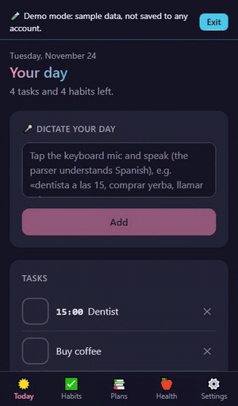
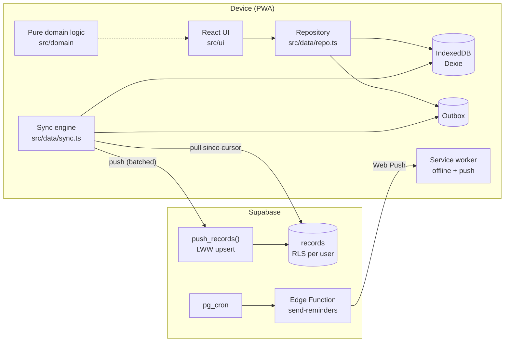

# Hábitos

[](https://github.com/Tata-14Dev/habitos-app/actions/workflows/ci.yml)

**A local-first habit tracker and study planner for phone and desktop.** It's an installable PWA that works fully offline, syncs between devices through Supabase, and sends a morning push notification to your iPhone.

> **Live demo:** [open it with sample data](https://habitos-app-vtve.vercel.app/?demo=1) — six weeks of habits, a course halfway through, charts and health, in a separate local database (no account needed). The UI switches to English or Spanish with your device. · 🇦🇷 [Leer en español](README.es.md)

<p align="center">
  
</p>

<p align="center">
  
  
  
  
  
  
</p>

| Lighthouse (mobile, production) | Performance | Accessibility | Best practices | SEO |
|---|---|---|---|---|
| [habitos-app-vtve.vercel.app](https://habitos-app-vtve.vercel.app/?demo=1) | 92 | 100 | 100 | 100 |

## Why I built it

I used to track habits and study plans in spreadsheets. They were fine on a laptop, but painful on a phone. They also couldn't answer the question I cared about most: *"If I study 3 lessons today, when do I finish?"* This app replaces those spreadsheets with something I open every morning.

## Features

- **Daily briefing.** Today's tasks, habits, active study plans, and a mood and motivation check-in, all on one screen.
- **Voice-dictated tasks.** Say *"dentista a las 15 horas, comprar yerba, después llamar a Juan"* with the iPhone keyboard mic and get three tasks, one of them at 15:00. The parser is rule-based. It splits on punctuation and connectors ("después", "luego", "también") and understands Spanish time phrases such as *"9 y media"*, *"3 de la tarde"*, *"18.30 hs"* and *"al mediodía"*.
- **Three kinds of habits.** *Fixed* routines every day (make the bed, walk the dog), optionally tied to morning, afternoon, or night; *day-specific* habits on some weekdays or a single date; and *progress* habits with an amount per day or per week (1 h a day, 5 h a week) or a number of times per week (gym 3×). "Today" shows only what's due, grouped by moment of the day, plus this week's goals.
- **Fair percentages and streaks.** A habit only counts on days it's due and within its start/end dates, so adding, retiring, or rescheduling a habit never distorts past percentages. Daily streaks skip the days a habit isn't due; weekly goals keep streaks in weeks. Monthly grid and trend charts included.
- **Study plans that reschedule themselves.** Two kinds: **item plans** (a list of rooms, lessons, or chapters, pasted one per line with optional `Module: item`) and **amount plans** (a total of hours, pages, or exercises, logged per day). Just say how many ("34 rooms") and the daily pace: the end date is computed for you, skipping rest weekdays and blocked dates (or set your own deadline). Already halfway through a course? Say "62 in total, done up to 31": rooms 1–31 count as done before the plan, the schedule starts at room 32, and the app shows "You're on: Room 32". Every check-off recalculates the projected finish date, how far ahead or behind you are, and the pace you need. A plan can be linked to a habit that is marked done on any day you make progress.
- **Offline-first PWA.** The whole app is precached by a Workbox service worker. Every write goes to IndexedDB first, so the app never waits on the network.
- **Multi-device sync, live.** Email and password auth with Supabase and last-write-wins conflict resolution. Changes made on one device show up on the others in under a second (Supabase Realtime), with polling as a fallback.
- **Push notifications.** A morning reminder with the day's tasks, plan items and habits, and a Sunday-night weekly summary (habits % vs. last week, progress per plan, weight change). Web Push to the installed iOS PWA, scheduled with `pg_cron` and sent by a Supabase Edge Function in each user's local time zone.
- **Burn-up and yearly view.** Each plan charts its original plan, actual progress and projection. A yearly view shows the % per month and a "year in pixels" of every day.
- **Statistics.** Inside Habits: 30-day consistency per habit with its trend, completion by weekday, mood on good days vs the rest, and each plan's weekly pace against what it needs. Every habit has its own page with streaks, charts and a 12-month calendar.
- **Optional weight & calorie tracking.** Turned on in Settings. Log meals by typing what you ate (`200 g arroz, 2 huevos, 1 taza de leche`): the app looks each food up in a built-in dictionary of ~300 Argentine foods (approximate values) plus your own "Mis alimentos" and computes the kcal, with a live preview; plain kcal still works. See [docs/COMIDAS.md](docs/COMIDAS.md). Track that against a daily target and one weigh-in a day. Because daily weight is noisy, the app shows a 7-day trend, a weekly rate from a least-squares fit over the last 4 weeks, and the date you'd reach your goal weight at that rate.
- **Themes.** A neon pink and sky-blue default ("Neón", night-indigo base) plus three presets, or a custom primary + accent + base. Every color was generated in OKLCH and validated: text on buttons ≥ 4.5:1, chart colors legible on the surface, shade ramps that read in order, and primary/accent pairs that stay distinguishable for color-blind people. Pairs that fail are disabled in the picker. The choice syncs across devices.
- **Spanish and English.** The UI follows the device language (or a setting): texts, dates and number formats. Voice dictation and meal parsing understand Spanish, since they're built around Argentine phrasing and foods. A unit test fails if any UI string lacks a translation.
- **Demo mode.** [`?demo=1`](https://habitos-app-vtve.vercel.app/?demo=1) opens six weeks of sample data in a separate local database, with sync turned off, so you can explore everything without an account.
- **Backup.** Export and import of all data as JSON.

## Architecture



### Interesting decisions

The full write-up (sync protocol, security model, scheduling rules, trade-offs) is in [`docs/ARCHITECTURE.md`](docs/ARCHITECTURE.md).

- **Local-first with an outbox.** The UI never talks to the network. Each write stamps `updatedAt` and adds the record to an outbox in the same Dexie transaction. A sync engine drains the outbox in batches: after each change (debounced), on app start, when the device comes back online, when the app returns to the foreground, and once a minute while it's visible.
- **One generic table on the server.** Every local collection maps to a row in `records(user_id, collection, id, data jsonb, updated_at, deleted_at, server_ts)`. Adding a new collection needs no migration.
- **Last-write-wins enforced in SQL.** `push_records()` runs a single `INSERT … ON CONFLICT DO UPDATE … WHERE excluded.updated_at > r.updated_at`, so the server rejects stale writes. Client timestamps are strictly increasing, which means two writes in the same millisecond never tie.
- **Server clock for pull cursors.** Device clocks drift, so pulls use a server-side `server_ts` (`clock_timestamp()`) plus a small overlap window instead of the client's `updatedAt`.
- **Soft deletes.** `deletedAt` tombstones propagate deletions across devices.
- **Row Level Security.** One policy, `user_id = auth.uid()`, isolates each user's data. The client only ever holds the publishable key.
- **Dates as local `YYYY-MM-DD` strings.** Days are never stored as UTC timestamps, which avoids the classic "habit marked on the wrong day after 9 p.m." bug in UTC−3.
- **Pure, tested domain layer.** Scheduling, percentages, streaks, the dictation parser, item-list parsing, and the reminder logic are plain TypeScript with no React or I/O, covered by Vitest.

## Scheduling engine

The core of the study planner is `src/domain/schedule.ts` (item plans) and `src/domain/progress.ts` (amount plans). They count available days given rest weekdays and blocked dates, build a baseline schedule, project a new one from today based on actual progress, and compute metrics: days ahead or behind, projected finish date, margin to the deadline, and required pace.

One rule drives the projection: **doing extra never pushes work forward.** Today's quota is `max(0, pace − doneToday)`, so finishing 3 lessons on a 1-a-day plan moves the next lesson to *tomorrow* (not three days out) and pulls the finish date closer.

The engine was specified **test-first**: 57 Vitest tests and a design guide with edge cases ([`docs/GUIA_REPROGRAMACION.md`](docs/GUIA_REPROGRAMACION.md)) were written before any implementation. The guide also walks through the final solution line by line.

## Tech stack

| Layer | Tools |
|---|---|
| Frontend | React 19, TypeScript, Vite, Tailwind CSS 4, React Router |
| Local data | IndexedDB via Dexie (`dexie-react-hooks` for live queries) |
| Backend | Supabase: Postgres, Auth, RLS, Edge Functions (Deno), `pg_cron` |
| PWA | `vite-plugin-pwa` (injectManifest), Workbox, Web Push (VAPID) |
| Charts and UI | Recharts, dnd-kit (drag-to-reorder) |
| Testing | Vitest + `fake-indexeddb` (domain, store, sync, i18n coverage), Playwright (end-to-end on an emulated iPhone, in Spanish and English), SQL RLS checks |
| CI | GitHub Actions: lint, types, unit tests, build and e2e on every push |
| Hosting | Vercel |

## Project structure

```
src/domain     pure logic: dates, habits, tasks (dictation parser), plans, schedule, progress, health
src/data       Dexie schema, outbox store, sync engine, repository, backup, push subscription
src/ui         screens and components
src/charts     Recharts wrappers
src/sw.ts      service worker: offline precache + push notifications
supabase/      SQL migrations, send-reminders Edge Function, cron setup
e2e/           Playwright smoke test
```

## Running it locally

```bash
npm install
npm run dev          # http://localhost:5173 (works without any keys: local-only mode)
npm test             # Vitest
npm run e2e          # Playwright (emulated iPhone 13)
npm run build        # production build with service worker
npm run test:rls     # Row Level Security checks against the linked Supabase project (rolled back)
```

To enable sync and push, copy `.env.example` to `.env.local` and fill in your Supabase URL, publishable key, and VAPID public key. The full guide covers the Supabase setup, migrations, the Edge Function, cron, the Vercel deploy, and installing on an iPhone. It's in Spanish: [`docs/SETUP.md`](docs/SETUP.md).

> **Windows note:** use `npm test`, not `npx vitest`. A wrapper script fixes a drive-letter casing issue that makes Vitest load the suite twice.

## How it was built

I built this with an AI pair programmer (Claude Code) under an explicit working agreement, documented in [`CLAUDE.md`](CLAUDE.md). I defined the product, the requirements, and the scheduling rules. The AI implemented the code, with each module covered by tests. The scheduling engine started as a hands-on exercise for me (the spec and guide were written for that) and was later completed with the AI, with every function explained line by line in the guide.

## Roadmap

- CSV export
- Push notifications in English (they're Spanish-only today)
- Meal parsing in English

More ideas are in [`IDEAS.md`](IDEAS.md).

## License

[MIT](LICENSE)
