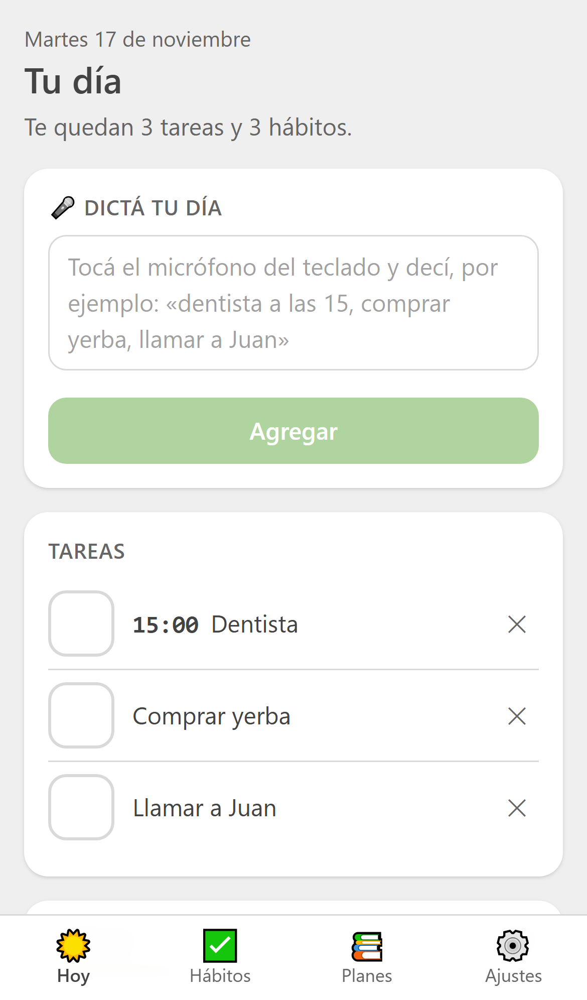
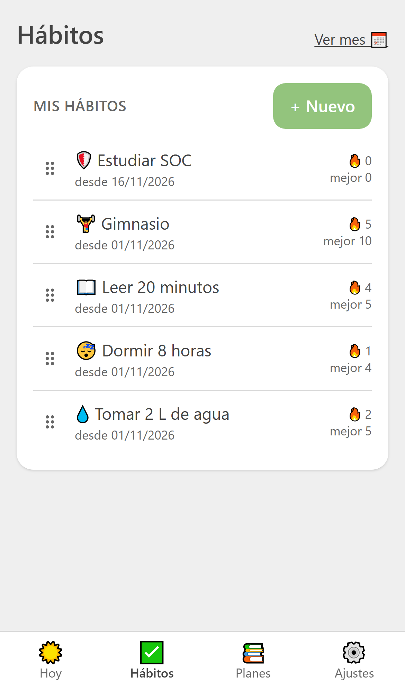
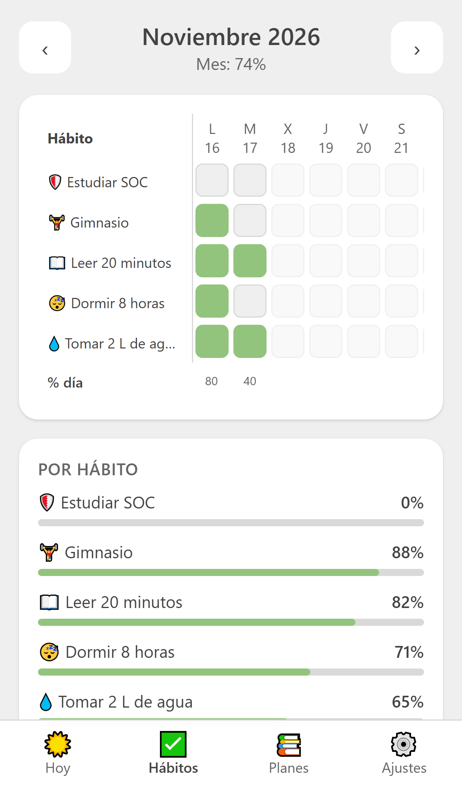
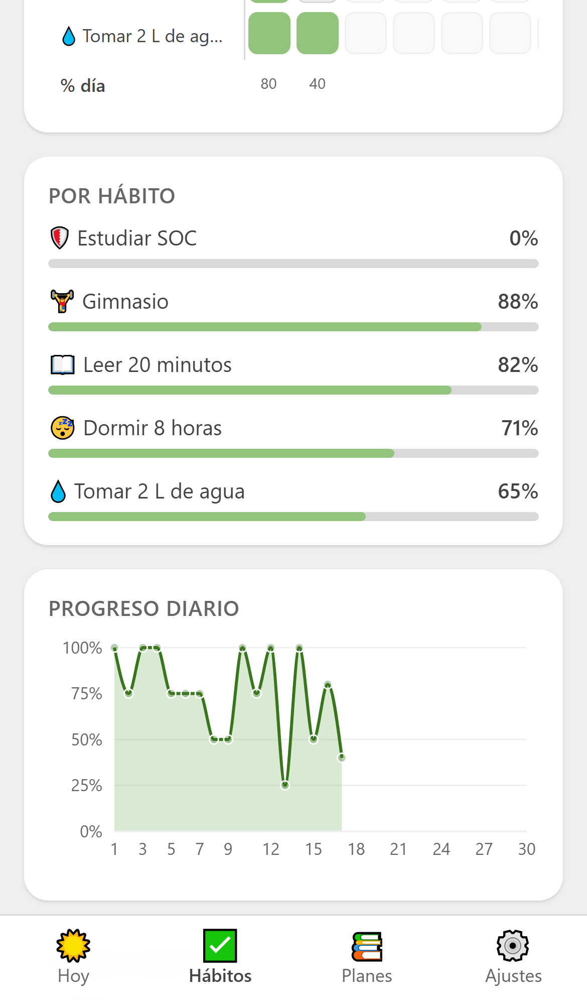
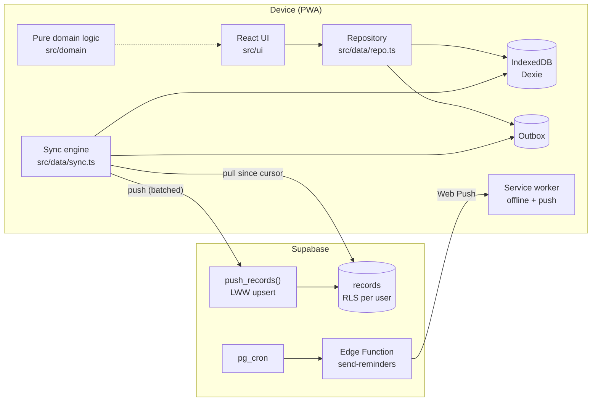

# Hábitos

**A local-first habit tracker and study planner for phone and desktop.** It's an installable PWA that works fully offline, syncs between devices through Supabase, and sends a morning push notification to your iPhone.

> **Live demo:** [habitos-app-vtve.vercel.app](https://habitos-app-vtve.vercel.app) (works in local-only mode without an account) · 🇦🇷 [Leer en español](README.es.md) · The app's UI is in Argentine Spanish.

<p align="center">
  
  
  
  
</p>

## Why I built it

I used to track habits and study plans in spreadsheets. They were fine on a laptop, but painful on a phone. They also couldn't answer the question I cared about most: *"If I study 3 lessons today, when do I finish?"* This app replaces those spreadsheets with something I open every morning.

## Features

- **Daily briefing.** Today's tasks, habits, active study plans, and a mood and motivation check-in, all on one screen.
- **Voice-dictated tasks.** Say *"dentista a las 15 horas, comprar yerba, después llamar a Juan"* with the iPhone keyboard mic and get three tasks, one of them at 15:00. The parser is rule-based. It splits on punctuation and connectors ("después", "luego", "también") and understands Spanish time phrases such as *"9 y media"*, *"3 de la tarde"*, *"18.30 hs"* and *"al mediodía"*.
- **Habits with validity ranges.** A habit only counts on days between its start and end dates, so adding or retiring a habit doesn't distort past percentages. Includes current and best streaks, a monthly grid, and trend charts.
- **Study plans.** Import a list of items (one per line, with optional `Module: item`), set a pace, rest weekdays, and blocked dates, and track milestones. A plan can be linked to a habit, which is marked done automatically on any day you complete an item.
- **Offline-first PWA.** The whole app is precached by a Workbox service worker. Every write goes to IndexedDB first, so the app never waits on the network.
- **Multi-device sync.** Email and password auth with Supabase, plus last-write-wins conflict resolution.
- **Morning push reminder.** Web Push to the installed iOS PWA, scheduled with `pg_cron` and sent by a Supabase Edge Function in each user's local time zone.
- **Backup.** Export and import of all data as JSON.

## Architecture



### Interesting decisions

- **Local-first with an outbox.** The UI never talks to the network. Each write stamps `updatedAt` and adds the record to an outbox in the same Dexie transaction. A sync engine drains the outbox in batches: after each change (debounced), on app start, when the device comes back online, when the app returns to the foreground, and once a minute while it's visible.
- **One generic table on the server.** Every local collection maps to a row in `records(user_id, collection, id, data jsonb, updated_at, deleted_at, server_ts)`. Adding a new collection needs no migration.
- **Last-write-wins enforced in SQL.** `push_records()` runs a single `INSERT … ON CONFLICT DO UPDATE … WHERE excluded.updated_at > r.updated_at`, so the server rejects stale writes. Client timestamps are strictly increasing, which means two writes in the same millisecond never tie.
- **Server clock for pull cursors.** Device clocks drift, so pulls use a server-side `server_ts` (`clock_timestamp()`) plus a small overlap window instead of the client's `updatedAt`.
- **Soft deletes.** `deletedAt` tombstones propagate deletions across devices.
- **Row Level Security.** One policy, `user_id = auth.uid()`, isolates each user's data. The client only ever holds the publishable key.
- **Dates as local `YYYY-MM-DD` strings.** Days are never stored as UTC timestamps, which avoids the classic "habit marked on the wrong day after 9 p.m." bug in UTC−3.
- **Pure, tested domain layer.** Percentages, streaks, the dictation parser, item-list parsing, and the reminder logic are plain TypeScript with no React or I/O, covered by Vitest.

## Scheduling engine (in progress)

The core of the study planner is `src/domain/schedule.ts`. It counts available days given rest weekdays and blocked dates, builds a baseline schedule, projects a new one from today based on actual progress, and computes metrics such as days ahead or behind and the projected finish date.

I'm implementing this module **by hand, test-first**, as a deliberate exercise in algorithmic thinking. The specification already exists as **57 Vitest tests** (`src/domain/schedule.test.ts`), and a design guide with edge cases is in [`docs/GUIA_REPROGRAMACION.md`](docs/GUIA_REPROGRAMACION.md). Until each function is done, the UI catches `NotImplementedError` and shows a friendly "pending" notice instead of crashing.

## Tech stack

| Layer | Tools |
|---|---|
| Frontend | React 19, TypeScript, Vite, Tailwind CSS 4, React Router |
| Local data | IndexedDB via Dexie (`dexie-react-hooks` for live queries) |
| Backend | Supabase: Postgres, Auth, RLS, Edge Functions (Deno), `pg_cron` |
| PWA | `vite-plugin-pwa` (injectManifest), Workbox, Web Push (VAPID) |
| Charts and UI | Recharts, dnd-kit (drag-to-reorder) |
| Testing | Vitest + `fake-indexeddb` (domain, store, sync), Playwright (end-to-end on an emulated iPhone) |
| Hosting | Vercel |

## Project structure

```
src/domain     pure logic: dates, habits, tasks (dictation parser), plans, schedule
src/data       Dexie schema, outbox store, sync engine, repository, backup, push subscription
src/ui         screens and components
src/charts     Recharts wrappers
src/sw.ts      service worker: offline precache + push notifications
supabase/      SQL migrations, send-reminders Edge Function, cron setup
e2e/           Playwright smoke test
```

## Running it locally

```bash
npm install
npm run dev          # http://localhost:5173 (works without any keys: local-only mode)
npm test             # Vitest
npm run e2e          # Playwright (emulated iPhone 13)
npm run build        # production build with service worker
```

To enable sync and push, copy `.env.example` to `.env.local` and fill in your Supabase URL, publishable key, and VAPID public key. The full guide covers the Supabase setup, migrations, the Edge Function, cron, the Vercel deploy, and installing on an iPhone. It's in Spanish: [`docs/SETUP.md`](docs/SETUP.md).

> **Windows note:** use `npm test`, not `npx vitest`. A wrapper script fixes a drive-letter casing issue that makes Vitest load the suite twice.

## How it was built

I built this with an AI pair programmer (Claude Code) under an explicit working agreement, documented in [`CLAUDE.md`](CLAUDE.md). The AI handled the scaffolding, UI, and data and sync layers. The scheduling engine is mine to write, and the AI's role there is limited to hints and code review.

## Roadmap

- Finish the scheduling engine, then a burn-up chart per plan (baseline vs. actual vs. projection)
- Yearly overview (`yearStats` is already implemented and tested)
- CSV export
- Realtime sync with Supabase Realtime instead of polling

More ideas are in [`IDEAS.md`](IDEAS.md).

## License

[MIT](LICENSE)
