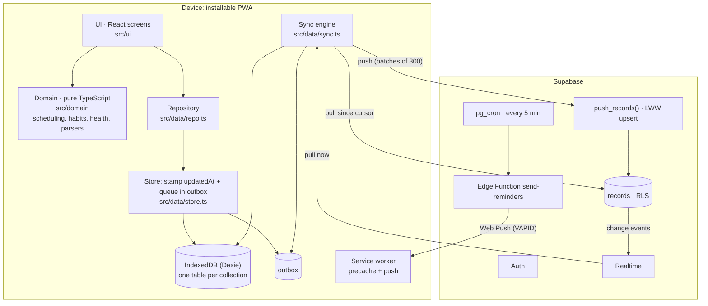

# Architecture

How Hábitos works under the hood, and why it's built this way. For the product overview see the [README](../README.md); for setup, [SETUP.md](SETUP.md) (Spanish).

## The shape of it



Three rules hold everywhere:

1. **The UI never waits for the network.** Every read is a live query on IndexedDB; every write goes to IndexedDB first.
2. **Business logic is pure.** `src/domain` has no React, no I/O and no `Date.now()` (today is a parameter), so it's tested directly with Vitest.
3. **Days are local `YYYY-MM-DD` strings**, never UTC timestamps. In UTC−3, a habit ticked at 22:00 belongs to *today*, not tomorrow.

## Data model

Locally there's one Dexie table per collection: `habits`, `habitLogs`, `dayMoods`, `plans`, `planItems`, `planLogs`, `milestones`, `projections`, `tasks`, `bodyWeights`, `foodEntries`, `customFoods`, `settings` and `pushSubscriptions`. Every record carries:

- `id`. Some ids are deterministic on purpose: a habit log is `habitId|date` and a weigh-in is its date. That way two devices ticking the same cell write to the same record instead of creating duplicates.
- `updatedAt`, an ISO instant, strictly increasing per device: two writes in the same millisecond still get different stamps.
- `deletedAt` (optional), a tombstone. Nothing is hard-deleted, so deletions sync.

On the server, every collection lives in **one generic table**:

```sql
records(user_id, collection, id, data jsonb, updated_at, deleted_at, server_ts)
primary key (user_id, collection, id)
```

Adding a collection (`planLogs`, `customFoods`, …) needed zero server migrations. The trade-off: the server can't query inside `data` efficiently. That's fine here, because the only server-side reader is the reminder function, and it reads one user at a time.

## Sync protocol

**Write path.** `store.put` stamps `updatedAt` and adds `collection|id` to the outbox **in the same Dexie transaction**, so a write is never lost between "saved" and "queued".

**Push.** The outbox is sent in batches of 300 to the `push_records(rows jsonb)` RPC, which runs a single statement:

```sql
insert … on conflict (user_id, collection, id) do update
  set … , server_ts = clock_timestamp()
  where excluded.updated_at > records.updated_at
```

That is, last-write-wins enforced by the database: a stale write can't overwrite a newer one, whatever order requests arrive in. An outbox entry is only removed if the record wasn't modified again during the request.

**Pull.** The device keeps a cursor on `server_ts`, the server's clock and not the client's. Device clocks drift, but the server's is monotonic for our purposes. Each pull asks for rows with `server_ts > cursor - 5 s`, paging by 1,000. The 5-second overlap covers transactions that commit out of order. Rows are merged with the same rule as the server (`remote.updatedAt > local.updatedAt`), and a pending local change that just lost is dropped from the outbox.

**When it runs.** A sync runs:

- 2 s after a local change (debounced);
- on start, on sign-in, when the device comes back online and when the app returns to the foreground;
- every minute while visible;
- **within 0.5 s of a change on another device**, through Supabase Realtime (`postgres_changes` on `records`, filtered by `user_id`).

Realtime only triggers a pull; the pull is still the source of truth. That's why a dropped socket only costs latency, never correctness.

**Accounts.** On sign-in, if the local data belongs to another account it's wiped. If it belongs to nobody (the app was used before signing in), it's adopted and queued for upload.

**Known limits** (accepted on purpose):

- LWW is per record, not per field. Two devices editing different fields of the same plan at the same time keep only the later edit. Records are small and edits are rare, so a CRDT wasn't worth it.
- `updatedAt` comes from the client clock, so a device with a clock far ahead wins conflicts it shouldn't. The pull cursor uses the server clock, so at least no change is ever *missed*.

## Security

- One RLS policy on `records`: `user_id = auth.uid()`, for both reading and writing (`using` + `with check`).
- `push_records` is `security invoker` and rejects anonymous callers, so it can't bypass RLS.
- `reminder_log` has RLS on and no policies: only the Edge Function (service role) can touch it.
- The client only ever holds the publishable key.
- `npm run test:rls` runs [supabase/tests/rls.sql](../supabase/tests/rls.sql) against the real database, inside a transaction that ends in `ROLLBACK`. It creates two throwaway users and checks that B can't read, update, delete or overwrite A's rows, can't insert rows as A, and that an anonymous visitor sees nothing.

## Scheduling engine

Two kinds of study plan share one set of day-arithmetic functions (`src/domain/schedule.ts`): `isAvailableDay`, `nextAvailableDay`, `nthAvailableDay` and `countAvailableDays`, all aware of rest weekdays and blocked dates.

- **Item plans** (`schedule.ts`): the *baseline* is the original plan. The item at position *i* goes on available day `floor((i − 1) / pace) + 1`, and the baseline only changes when the user explicitly re-plans. The *projection* is recomputed on every change: done items keep their real date, and pending items are spread from today.
- **Amount plans** (`progress.ts`): the same idea over a total (hours, pages) logged per day.

**The golden rule: doing extra never pushes work forward.** Today's quota is `max(0, pace − doneToday)`. If it were allowed to go negative, finishing three lessons today would move tomorrow's lesson three days out. Instead, the next one stays tomorrow and the finish date moves closer.

**Items done before the plan** (`prior`) handle starting a course halfway: "62 rooms, I'm on 32". They count toward the total and the "you're on" line, but they're excluded from scheduling, from "should have done by now" and from the burn-up.

The engine was specified test-first (57 tests plus a guide with edge cases, [GUIA_REPROGRAMACION.md](GUIA_REPROGRAMACION.md)) before any implementation was written.

## Habits

`isHabitScheduled(habit, date)` decides whether a habit is due on a day:

- **fixed**: every day;
- **scheduled**: on its weekdays, or on a single date;
- **progress per day**: every day;
- **weekly goals** (an amount per week, or N times per week): never part of a single day.

Percentages divide by habits *due* that day, so adding, retiring or rescheduling a habit never changes past percentages, and an off day is never a miss. Daily streaks skip the days a habit isn't due; weekly goals keep their streaks in weeks.

## Health and meal parsing

- **Weight:** shown as a 7-day trend rather than the raw weigh-in. The weekly rate comes from a least-squares line over the last 4 weeks, and the goal date extrapolates it.
- **Meals** are typed as text (`200 g arroz, 2 huevos y 1 taza de leche`), parsed into quantity, unit and food, then matched against a 300-food dictionary in this order: exact name or alias, plural, accent-insensitive, partial and fuzzy (edit distance). Each match comes with a confidence. The user's own foods take precedence. Nothing here calls a network service, so it works offline.

## Notifications

`pg_cron` calls the `send-reminders` Edge Function every 5 minutes. For each user, the function works out the local time from the stored time zone and decides whether something is due:

- the **morning reminder**, at their chosen time;
- the **weekly summary**, Sundays at 20:00: habits % vs the previous week, progress per plan, and weight change.

The deciding and message-building logic lives in `_shared/reminder.ts`, a pure module tested with Vitest. `reminder_log` keeps each from going out twice. Expired subscriptions (404/410) are soft-deleted, so devices find out through sync.

## Offline and performance

- A Workbox service worker (`injectManifest`) precaches every chunk. The app is fully usable offline, including screens never opened before.
- Only *Today* ships in the initial bundle. Every other screen, Recharts and the food dictionary are lazy-loaded, which brought the initial JS from 358 kB to about 195 kB gzipped.
- Dexie asks for persistent storage, so iOS doesn't evict the data.

## Theming

Colors are CSS variables on `<html>` (`--c-primary`, `--c-accent`, paper/ink and the whole neutral scale), and Tailwind's tokens point at them. Switching theme or light/dark mode rewrites those variables; charts read the same palette through a hook, because Recharts needs real color values.

The palette is **generated, not hand-picked**. For each of six hues, a script computes in OKLCH:

- a button tone per mode, with text on it ≥ 4.5:1;
- a chart tone inside the lightness band, with chroma ≥ 0.1 and ≥ 3:1 on the surface (cyan can't be both dark and saturated in sRGB, so its lightness is searched rather than fixed);
- a 5-step shade ramp (monotone, visible steps, light end ≥ 2:1 on the surface).

Then it runs the dataviz validator on every primary + accent pair, in both modes and on both bases. 12 of the 15 pairs pass and are stored in `COMPATIBLE`; the picker disables the other 3: sky blue + blue and violet + blue (too similar) and green + amber (they collapse under deuteranopia). Regenerate with `node scripts/palette-gen.mjs` (needs the validator path in `DATAVIZ_VALIDATOR`). Output: [`src/ui/palette.data.ts`](../src/ui/palette.data.ts).

## Demo mode

`?demo=1` (or "Probar la demo") switches the app to a **separate IndexedDB database** and disables Supabase entirely. A generator fills it with six weeks of data dated relative to today. Sample data can't mix with real data or sync to an account, and leaving the demo deletes the demo database.

## Testing

| Layer | Tool | What it covers |
|---|---|---|
| Domain | Vitest | Scheduling (57 spec tests), habits and types, health, meal parser, burn-up, reminders |
| Data | Vitest + `fake-indexeddb` | Store, outbox, LWW merge, schema versions |
| UI flows | Playwright (emulated iPhone 13) | Main flow and demo mode, against the production build |
| Security | SQL in a rolled-back transaction | RLS isolation between users and for anonymous visitors |
| CI | GitHub Actions | Lint, types, unit tests, build and e2e on every push |

## What I'd do differently at scale

- Move from per-record LWW to per-field merges (or a CRDT for text fields) if collaboration ever mattered.
- Replace the generic `records` table with typed tables once server-side queries are needed (analytics, sharing).
- Use a hybrid logical clock instead of client wall-clock time for `updatedAt`.
